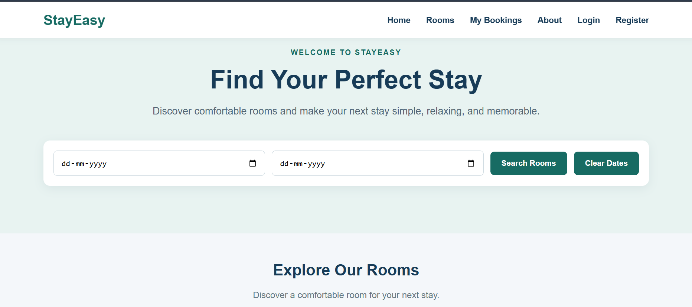
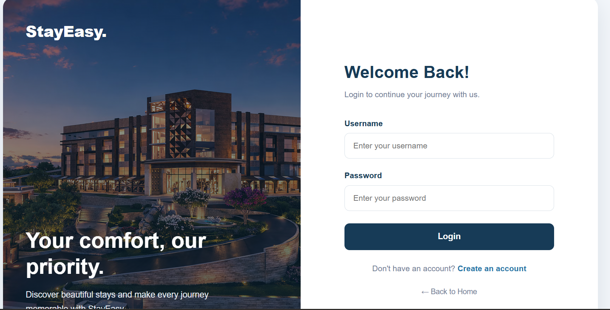
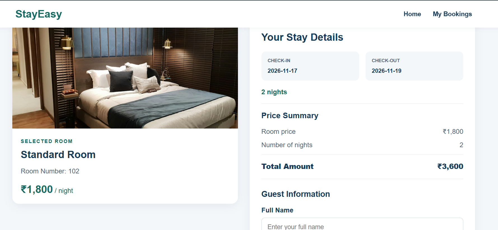
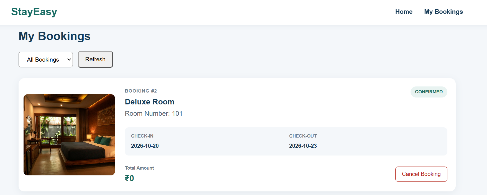

# StayEasy – Hotel Booking System

A full-stack Hotel Booking System built using **Spring Boot, React, and MySQL**.

Users can register, log in, browse hotel rooms, make bookings, view their booking history, and cancel reservations.

## Features

### User Features
- User registration and login
- Browse available hotel rooms
- Select check-in and check-out dates
- Book hotel rooms
- View personal booking history
- Filter bookings by status
- Cancel confirmed bookings
- Prevent overlapping bookings for the same room
- User-specific booking access

### Admin Features
- Role-based access control (USER and ADMIN)
- Add new hotel rooms
- Update room details
- Delete hotel rooms
- Only administrators can manage rooms

## Technologies Used

### Backend
- Java 25
- Spring Boot
- Spring Data JPA
- Spring Security
- MySQL
- Maven
- REST APIs

### Frontend
- React
- JavaScript
- HTML
- CSS
- Axios
- React Router
- Vite

## Project Structure

The project contains two separate applications.

**Backend – Spring Boot**
- Handles business logic, authentication, room management, and bookings.
- Connects to the MySQL database.

**Frontend – React**
- Provides the user interface.
- Communicates with the backend through REST APIs.

## Screenshots

### Home Page


### Login Page


### Booking Page


### My Bookings


## Setup Instructions

### Prerequisites
- Java JDK 25
- Node.js and npm
- MySQL Server 8
- Spring Tool Suite (STS) or another Java IDE
- Visual Studio Code or another code editor

### 1. Clone the repositories

**Backend:**
```bash
git clone https://github.com/magapudurgavenkatesh/hotel-booking-system-backend.git
```

**Frontend:**
```bash
git clone https://github.com/magapudurgavenkatesh/-hotel-booking-system-frontend.git
```

### 2. Configure the MySQL database

Create a database named:

```sql
CREATE DATABASE hotel_booking;
```

Configure the following environment variables for the backend:

```text
DB_USERNAME=your_mysql_username
DB_PASSWORD=your_mysql_password
```

Never upload actual database passwords to GitHub.

### 3. Run the Backend

1. Open the backend project in STS.
2. Configure the database environment variables.
3. Run the Spring Boot application.

Backend URL:

`http://localhost:8080`

### 4. Run the Frontend

1. Open the frontend project in VS Code.
2. Open the terminal.
3. Install dependencies:

```bash
npm install
```

4. Start the development server:

```bash
npm run dev
```

Frontend URL:

`http://localhost:5173`

## API Overview

| Method | Endpoint | Purpose |
|---|---|---|
| POST | `/auth/register` | Register a new user |
| GET | `/auth/me` | Get authenticated user details |
| GET | `/rooms` | View hotel rooms |
| POST | `/rooms` | Add a room (ADMIN) |
| PUT | `/rooms/{id}` | Update a room (ADMIN) |
| DELETE | `/rooms/{id}` | Delete a room (ADMIN) |
| POST | `/bookings` | Create a booking |
| GET | `/bookings` | View authenticated user's bookings |
| GET | `/bookings/{id}` | View booking details |
| PUT | `/bookings/{id}` | Update a booking |
| DELETE | `/bookings/{id}` | Cancel a booking |
| GET | `/bookings/search` | Search bookings |

## Authentication and Authorization

- Spring Security handles authentication and authorization.
- Passwords are stored using password encoding.
- HTTP Basic Authentication is used for authenticated API requests.
- Users can access their own bookings.
- ADMIN users can manage hotel rooms.
- New registrations receive the USER role by default.

## Important Notes

- Both frontend and backend must be running to use the application locally.
- Configure your own database credentials before starting the backend.
- This project is intended as a learning and portfolio project. Its authentication approach should be strengthened before production deployment.

## GitHub Repositories

**Backend:**  
https://github.com/magapudurgavenkatesh/hotel-booking-system-backend

**Frontend:**  
https://github.com/magapudurgavenkatesh/-hotel-booking-system-frontend

## Author

Developed as a full-stack Java learning project using Spring Boot and React.